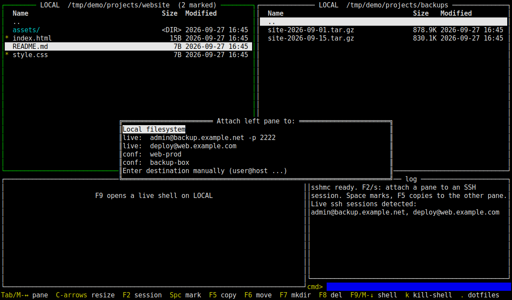

# sshmc — dual-pane SSH file commander

A Midnight-Commander-style terminal UI for moving files between machines over
SSH. Each pane can point at the local filesystem **or any SSH host**, including a
different host per pane, so you can copy directly between two servers. It
finds the SSH sessions you already have open and reuses their destination,
port and key, so there is nothing to configure.



*Demo data; hosts are `example.com` placeholders.*

## Features

- Two independent panes: local, `live:` (ssh processes already running on this
  machine), `conf:` (`~/.ssh/config` aliases) or a manually typed destination.
- Copy / move / mkdir / delete with multi-select, between any two panes,
  including remote to remote on different hosts.
- Fast: one multiplexed OpenSSH ControlMaster per host, so you authenticate once.
- Go version: embedded pure-Go rsync client for delta transfers, a real
  embedded terminal per connection (F9), mouse support, resizable splits,
  Linux/macOS and Windows builds from one codebase.
- Optional "pinned" server that opens automatically in the right pane
  (configured by environment variables, see below).

## Two implementations

- **Go (recommended)**: `go/` — single static binary, transfers via an
  embedded pure-Go **rsync** client ([gokrazy/rsync](https://github.com/gokrazy/rsync)).
- **Python**: `sshmc.py` — the original Textual version (`python3 sshmc.py`).

## Quick start

```bash
# Go 1.25+
cd go
go build -buildvcs=false -o sshmc .
./sshmc

# Windows cross-compile
GOOS=windows GOARCH=amd64 go build -buildvcs=false -o sshmc.exe .

# Tests (headless, via tcell's simulation screen)
go test -buildvcs=false ./...
# Integration tests that attach to ssh sessions already running on this machine:
SSHMC_LIVE_TESTS=1 go test -buildvcs=false ./...
```

Python version: `pip install textual && python3 sshmc.py`.

Requirements: an OpenSSH client (`ssh`, `scp`). Remote hosts need `rsync` for
rsync transfers (the Go version falls back to `scp -r` without it).

## Pinned server (optional)

Set these before starting the Go version to have one server connected
automatically in the right pane and listed as `pinned:` in the F2 picker.
Nothing is compiled into the binary; the key file is used in place.

| Variable | Meaning |
|----------|---------|
| `SSHMC_PIN_HOST` | host name or address (enables the feature) |
| `SSHMC_PIN_USER` | login user (optional) |
| `SSHMC_PIN_PORT` | port (optional) |
| `SSHMC_PIN_IDENTITY` | path to a private key (optional; otherwise ssh-agent / `~/.ssh/config`) |
| `SSHMC_PIN_DIR` | directory to open (optional; otherwise the remote home) |
| `SSHMC_PIN_KNOWN_HOSTS` | known_hosts file with the server's host keys; enforces `StrictHostKeyChecking=yes` |

```bash
SSHMC_PIN_HOST=files.example.com SSHMC_PIN_USER=deploy \
SSHMC_PIN_IDENTITY=~/.ssh/id_ed25519 SSHMC_PIN_DIR=/srv/uploads ./sshmc
```

### Windows notes

Runs on Windows 10 (1809+) / Windows 11 with the built-in OpenSSH client
(`ssh.exe`/`scp.exe`, enabled by default on Win11). Differences from Linux:

- **No ControlMaster**: Windows OpenSSH doesn't support connection
  multiplexing, so every listing/copy opens its own SSH connection. Use
  key-based auth with the `ssh-agent` service (`Set-Service ssh-agent
  -StartupType Automatic; Start-Service ssh-agent; ssh-add`) or you'll get
  prompted/refused per operation (ops run in BatchMode).
- **Live sessions** are discovered via CIM (`Win32_Process`, `ssh.exe`);
  relative `-i` key paths can't be resolved to the launching directory.
- **Live shells** use ConPTY; the local shell is PowerShell.
- Best used from **Windows Terminal** (proper color + key support).

Both implementations share the same keys and behavior (documented below).

## Attaching a pane to an SSH session (F2)

The session picker offers:

- **Local filesystem**
- **live:** — SSH sessions currently running on this machine, discovered from
  `ps`. Ports (`-p`), identity files (`-i`, resolved against the process's
  cwd via `/proc`), login user (`-l`), jump hosts (`-J`) and `-o` options are
  all picked up from the live command line.
- **conf:** — Host aliases from `~/.ssh/config`
- **manual** — type `user@host [-p N] [-i key]`

sshmc opens its own multiplexed **ControlMaster** connection per host
(sockets in `~/.cache/sshmc/`, kept alive 10 min after last use), so it
authenticates once and every listing, copy, and command after that is
instant. If auth needs a password/passphrase, the UI suspends so you can
answer the prompt, then resumes.

> Note: an existing ssh session is used to *identify* the destination and its
> key/port; file traffic flows over sshmc's own multiplexed connection using
> the same credentials — the running session itself is never disturbed.

## Keys

| Key | Action |
|-----|--------|
| `Tab` | switch pane |
| `Alt+←` / `Alt+→` | focus left / right pane (Go only; works from inside the shell too) |
| `Alt+↓` / `Alt+↑` | jump into the live shell / back to the files (Go only) |
| `Ctrl+←` / `Ctrl+→` | move the vertical pane split (Go only, from a file pane) |
| `Ctrl+↑` / `Ctrl+↓` | grow / shrink the terminal+log area (Go only, from a file pane) |
| `Alt+Tab` | switch file pane from anywhere — including from inside the live shell (Go only; plain Tab inside the shell still does completion) |
| `F2` / `s` | attach pane to a session (local / live ssh / config / manual) |
| `Enter` | enter directory (on a file: view first 20 KB) |
| `Backspace` | parent directory |
| `Space` / `Insert` | mark/unmark file (multi-select) |
| `F5` / `c` | copy marked (or cursor) items to the **other** pane |
| `F6` / `m` | move items to the other pane |
| `F7` / `n` | make directory |
| `F8` / `d` | delete (with confirmation) |
| `F3` / `v` | view file head in the log |
| `F4` / `r` | refresh both panes |
| `F9` | open/focus the **live shell** for the active pane's connection (Go only; F9 again returns to files) |
| `k` | **kill** the active connection's shell — escape hatch for a wedged terminal; next `F9` starts a fresh one (Go only, from a file pane) |
| `.` | show/hide dotfiles in the active pane (Go only) |
| `:` or `` ` `` | focus command bar (`Esc` returns to files) |
| `F10` / `q` | quit |

## Mouse (Go version)

The mouse is enabled: **click** any file pane, the terminal, or the command
bar to focus it (clicking a file row also moves the cursor; wheel scrolls);
**drag the divider** between the two file panes to change the split, or drag
the border between the file panes and the terminal/log area to change its
height. Note: with mouse mode on, select-to-copy in your outer terminal
usually needs Shift held (standard for mouse-enabled TUIs like mc).

## Live shells (Go version)

`F9` opens a **real interactive terminal** (embedded PTY + vt10x emulator) in
the bottom-left pane: local panes get your `$SHELL`, remote panes get an
interactive `ssh` shell over the existing mux socket (instant, no re-auth),
started in the pane's current directory. One shell is kept **per connection**
and survives pane switches — the bottom pane always shows the shell belonging
to the active pane's host. While focused, *all* keys go to the shell
(including Ctrl-C, tab-completion, vim, htop…); `F9` returns to the file
panes. Type `exit` to close a shell. Wide emoji glyphs in fancy prompts may
render slightly misaligned.

If a shell wedges completely (hung ssh, a command trapping SIGINT), `F9` /
`Alt+↑` always get you back to the file panes — they're handled by the app,
not the shell — and `k` force-kills that connection's shell so the next `F9`
starts a clean one.

## Command bar

Commands run on the **active pane's** host, in its current directory
(locally via your shell, remotely via `ssh host "cd … && (cmd)"`).
`cd <path>` changes the pane's directory. Output appears in the log pane.

## How transfers work

| Direction | Go version | Python version |
|-----------|------------|----------------|
| local ↔ remote | embedded pure-Go **rsync** client (gokrazy/rsync) over the mux socket — delta transfer, `-a` attribute preservation; falls back to `scp -r` if the remote has no rsync binary | `scp -r` over the mux socket |
| remote ↔ remote (different hosts) | `tar cf - \| tar xf -` piped through this machine — each leg keeps its own port/key/jump flags (which `scp -3`/rsync can't express for two remotes) | same |
| remote ↔ remote (same host) | `cp -a` server-side (no network round-trip) | same |
| local ↔ local | `cp -a` | same |

Go rsync notes: no local rsync binary is needed (the wire protocol is spoken
in-process); the *remote* host needs a normal `rsync` for `rsync --server`.
gokrazy/rsync's Landlock self-sandbox is disabled (`DontRestrict`) since a
file manager must reach arbitrary paths.

Directories copy recursively; existing files are overwritten (the confirm
dialog reminds you). Moves are copy + delete-source.

## Notes / limits

- Remote listing parses `ls -lA --time-style=+%s` (GNU) with a fallback for
  BSD-style `ls`; exotic filenames with newlines will confuse it.
- The command bar runs one-off commands, not a terminal: interactive programs
  (vim, top) won't work there. In the Go version use the F9 live shell instead.
- Password-auth hosts work (the TUI suspends for the prompt); once the master
  socket exists, no more prompts.

## Architecture

- **Session discovery** (`go/proc_*.go`, `go/ssh.go`): parses `ps -eo pid,args`
  (CIM `Win32_Process` on Windows) for running `ssh` clients and pulls out
  user, port, `-i` key (relative paths resolved via `/proc/<pid>/cwd`), `-J`
  and `-o` options. `~/.ssh/config` `Host` aliases are listed too.
- **Connections**: sshmc never touches your live session; it opens its own
  ControlMaster sockets at `~/.cache/sshmc/cm-%C` (`ControlPersist=600`) with
  the same credentials. Windows OpenSSH has no ControlMaster, so each operation
  opens its own connection there (use ssh-agent).
- **Listing** (`go/list.go`): `ls -lA --time-style=+%s` with a BSD `ls` fallback.
- **Transfers** (`go/transfer.go`): gokrazy/rsync `rsynccmd` with
  `DontRestrict = true` (its Landlock self-sandbox would otherwise deny all
  file access) and `-e "ssh -o ControlPath=..."` so it rides the mux socket.
  Remote-to-remote uses a tar pipe because `scp -3` can't express per-host
  ports and keys.
- **UI** (`go/ui.go`, `go/term.go`): tview/tcell. Embedded shells use
  creack/pty (ConPTY on Windows) plus hinshun/vt10x rendered as a custom
  tview primitive; while a shell has focus every key, including Ctrl-C, is fed
  to the pty.

## Tech stack

Go 1.25, tview + tcell, gokrazy/rsync, creack/pty, UserExistsError/conpty,
hinshun/vt10x. Python version: Python 3.10+ and Textual.

## Status / limitations

- Personal tool, developed and tested on Linux. The Windows build
  cross-compiles from the same code; macOS is untested.
- Remote listing breaks on filenames containing newlines.
- Wide emoji in fancy shell prompts can render misaligned in the embedded terminal.
- The Python version has no embedded terminal, mouse or rsync; it is kept as
  the original, simpler implementation.

## License

MIT, see [LICENSE](LICENSE).
